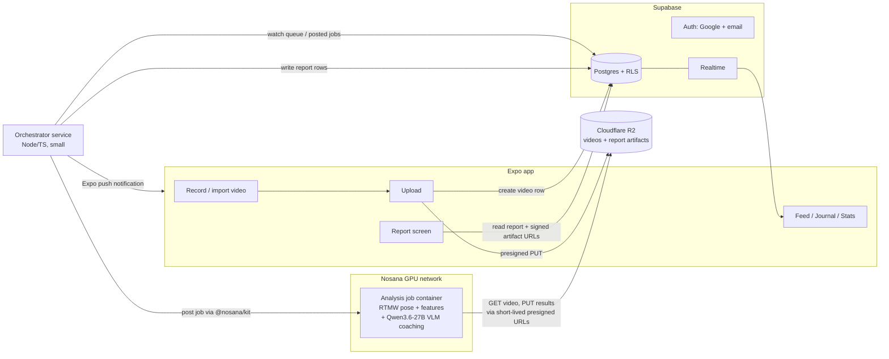

# ClimbIQ — Build Specification

**Audience:** the agent/developer building the ClimbIQ repository from zero. This document is self-contained — everything needed to build the product is in here.
**Date:** 2026-07-12
**Status:** All product decisions below were made explicitly by the project owner. Do not re-litigate them; open items are listed in §14.

---

## 1. What ClimbIQ is

ClimbIQ is a mobile app for boulderers. You film a climb (or import a video a friend filmed), the app sends it to GPU-hosted pose-estimation models, and you get back a one-shot **coaching report**: ranked technique issues with drills, a pose-overlay clip, biomechanics charts, technique scores, and a grade estimate. Around that core, the app is a climbing journal (log climbs, grades, progress stats), tracks whether your technique issues improve over time, and lets you share reports with friends in a simple feed.

**Feel:** fast, personal, and honest — like a knowledgeable friend reviewing your footage, not a chatbot. Analysis is fire-and-forget: upload, close the app, get a push notification when the report is ready.

## 2. Locked decisions

| Area | Decision |
|---|---|
| Audience at launch | Owner + friends; real multi-user auth and data model from day one, no app-store polish pressure |
| Mobile | Expo / React Native (TypeScript, expo-router) |
| v1 features | AI video coach, climb journal + stats, progress-over-time, social (share + friends feed) |
| Coach UX | One-shot report per video. No follow-up chat in v1 |
| Report contents | Issue cards + drills, pose-overlay clip, biomechanics timeline, technique scores + grade estimate |
| Capture | Record in-app (expo-camera) **and** import from gallery |
| Pose model | **RTMW/DWPose 2D wholebody** (133 keypoints incl. hands/feet, ONNX via `rtmlib`) — a single 2D model. SMPL-based 3D mesh models (HMR-family, GVHMR) were evaluated and **rejected**: research-only weight licenses and scale-ambiguous monocular depth (see §3 and §14) |
| Coaching LLM | **Qwen3.6-27B** (Apache 2.0, Apr 2026) quantized Q4 (~17 GB), run in-container. It is **multimodal**: it receives the structured `llm_context` **plus keyframe images** at detected-issue moments, so it visually verifies detections and supplies the holistic judgment 2D keypoints can't measure |
| Model hosting | **Nosana** GPU network runs the whole analysis (pose + VLM) as one job, posted via the **Nosana API** (`@nosana/kit` + dashboard API key + Credits). Owner's funded wallet is the fallback payment path |
| Job UX | Async: upload → leave → push notification when done |
| Backend | Supabase (auth, Postgres, realtime) + one small orchestrator service |
| Auth | Google sign-in + email/password (via Supabase Auth) |
| Video storage | Cloudflare R2 (S3-compatible, zero egress — jobs re-download videos) |
| Retention | **Reports are permanent; raw videos expire (~30 days).** Progress-over-time works off stored reports, never off re-analysis of raw video |
| Social scope | Share a report to friends + simple friends feed. No comments/likes in v1 |
| New repo | Monorepo: `/mobile`, `/backend`, `/nosana` |

## 3. Design rationale & engineering ground rules

**Why the analysis is designed this way:**
- **Wholebody 133-keypoint pose, not 17-keypoint COCO.** The coaching value of bouldering analysis lives in the extremities: finger keypoints enable grip classification (crimp / open-hand / sloper, full-crimp injury risk), foot keypoints enable heel-hook / toe-hook / smear / edge detection. A body-only skeleton can't see any of that.
- **2D keypoints + a vision LLM, not monocular 3D mesh models.** SMPL-based 3D reconstruction (HMR-family, GVHMR) looks attractive but has two disqualifiers: the weights carry research-only / non-commercial licenses, and single-camera depth is scale-ambiguous — thresholds built on it measure noise. Everything measurable comes from 2D keypoints normalized to body scale; everything judgmental (body-to-wall distance, dynamic vs static style) comes from the multimodal coaching LLM looking at actual keyframes.
- **Rules first, LLM last.** The pipeline is pose → engineered features → rule-based issue detection → LLM. The LLM never sees raw keypoints and never decides *what* was detected — it verifies detections against keyframes, enriches them, and writes the prose. This keeps analysis cheap, debuggable, and consistent between runs.
- **`llm_context`.** The LLM receives one compact structured summary (duration, frames analyzed, ranked issues with evidence and timestamps, positives, grip distribution) plus keyframe images — never bulk data.
- **One ID threads everything.** A video's UUID keys its R2 objects, DB rows, Nosana job, and report artifacts.

**Engineering ground rules (non-negotiable):**
- Every backend capability ships together with the API route **and** the app screen that consumes it — never build either half in isolation.
- Commit in small increments from day one; the repo's HEAD must always reflect the real architecture.
- Inference processes load models once at startup, stream video frames (never decode a whole video into RAM), and cap concurrency explicitly.
- No debug servers, no hardcoded secret fallbacks, sanitize uploaded filenames, never return stack traces or internal errors to clients.
- Feature extraction always applies temporal smoothing; baselines come from percentiles over a time window, never a single frame; thresholds are normalized to body scale (e.g., torso length in pixels), never absolute units.
- Pose models receive a tracked person bbox from a detector — never a full-frame guess.
- Postgres with migration files and indexes from the first table.
- Third-party model code is a pinned dependency or a Dockerfile build-stage clone — never a copied-in source tree.
- This spec is the only planning document; update it whenever reality diverges.

## 4. System architecture



**Components:**
1. **Mobile app** (`/mobile`) — Expo RN app; talks to Supabase directly (auth, DB reads via RLS, realtime) and to the orchestrator for the few privileged operations (request upload URLs, enqueue analysis).
2. **Supabase** — Auth (Google + email/password), Postgres with Row-Level Security, realtime subscriptions for job status updates while the app is open.
3. **Orchestrator** (`/backend`) — one small TypeScript service (Fastify). Responsibilities: issue presigned R2 URLs, create/track analysis jobs, post jobs to Nosana via **`@nosana/kit`** (the current SDK — see §8.2), poll job status, validate results, write reports, send Expo push notifications, run the retention sweep. Stateless; all state in Postgres.
4. **Nosana analysis job** (`/nosana`) — one Docker image that does the entire per-video analysis (pose → features → scores → LLM coaching text) in a single GPU rental. See §8.
5. **Cloudflare R2** — raw videos (expiring), report artifacts (permanent: overlay clip, timeline JSON).

**Why one combined Nosana job instead of a persistent LLM endpoint:** at friends-scale, an always-on Ollama/vLLM endpoint job burns GPU money while idle. Running quantized Qwen3.6-27B *inside* the analysis container (after pose, on the same GPU) means one rental per video and zero idle cost. If volume grows, split the pipeline: the VLM becomes a persistent Nosana inference endpoint (Nosana supports `expose`d service jobs reachable at `https://<JOB_ID>.node.k8s.prd.nos.ci`) and the CV stage becomes a small fast-boot job on a cheaper low-VRAM market — the report contract doesn't change. Third-party serverless inference providers are **not** an option: model hosting stays on Nosana.

## 5. Monorepo layout

```
climbiq/
├── mobile/                  # Expo app (TypeScript)
├── backend/                 # Orchestrator service (Fastify + @nosana/kit)
│   └── supabase/            # supabase config + SQL migration files
├── nosana/
│   ├── analysis-job/        # Dockerfile, pipeline code (Python), job entrypoint
│   └── job-definition.json  # template posted via SDK
├── shared/                  # report JSON contract types (TS) + JSON Schema
└── CLIMBIQ_SPEC.md          # this document, kept current
```

## 6. Mobile app spec

**Stack:** Expo SDK (current), TypeScript strict, expo-router, `@supabase/supabase-js`, TanStack Query for server state, `expo-camera`, `expo-image-picker`, `expo-video`, `expo-notifications`, `react-native-gifted-charts` (or victory-native) for stats/timeline.

**Tabs:** Home · Climbs · Analyze · Feed · Profile

**Screens & flows:**
- **Onboarding/Auth** — Google button + email/password (Supabase Auth). Username + optional avatar on first login (writes `profiles`).
- **Analyze (core flow)** —
  1. Record with expo-camera (framing guidance overlay: "whole body + wall in frame, phone landscape or stable portrait, one climber") or pick from gallery.
  2. **Mandatory trim screen** before every upload (pre-filled to the full range, one tap to confirm): climbing videos routinely open with 10–15 s of chalking up and staring at the wall — every trimmed second saves GPU time and LLM tokens. Coach the user to cut to pull-on → top-out. Pre-checks after trim: duration ≤ 90 s, resolution ≥ 720p. Compress to ≤1080p H.264 to cut upload + GPU cost.
  3. `POST /videos` to orchestrator → presigned PUT URL → upload direct to R2 with progress bar. For in-app recordings, offer **"Save to device gallery"** (expo-media-library) after upload — the server copy expires (§11); the gallery copy is the user's permanent raw video.
  4. Job status screen (queued → on GPU → analyzing → writing report) driven by Supabase realtime on `analysis_jobs.status`; user can leave anytime — Expo push fires on completion or failure.
- **Report screen** — renders the report contract (§10): overlay clip player, issue cards (severity-colored, tap → seek video to evidence timestamp, drill text), biomechanics timeline synced two-way with the video scrubber (scrubbing the chart seeks the video and vice versa), score radar/bars + grade estimate, share button (visibility: private/friends). Shows "raw video available until <date>" so expiry is never a surprise.
- **Climbs (journal)** — CRUD climb logs (name, gym/location, grade, style, sent/attempt, notes, date). A climb may link to ≥0 analyzed videos/reports.
- **Stats / Progress** — classic journal stats (grade pyramid, sends over time) **plus** technique progress: per-issue trend lines from stored reports (e.g., "barn-door frames per climb, last 10 reports"). Data source: `reports` rows only (videos expire).
- **Feed** — reversed-chron list of friends' shared reports (thumbnail, grade, top issue, score). Tap → read-only report view. Friend management: search username → request → accept.
- **Profile** — avatar, stats summary, friends list, settings (notifications, account deletion).

**Rules:** no business logic in screens (hooks/services layer); all backend types imported from `/shared`; every list screen handles empty/loading/error states; no dead placeholder buttons — if a feature isn't built, it isn't shown.

## 7. Backend spec

### 7.1 Supabase
- Auth providers: Google + email/password. JWT verified by the orchestrator on every request.
- All tables have RLS. Baseline policies: owner full access on own rows; friends can `SELECT` reports with `visibility='friends'` via the `friendships` join; `analysis_jobs` readable by video owner only.
- Realtime enabled on `analysis_jobs` (status) and `reports` (feed inserts).
- Schema managed exclusively through SQL migration files in `backend/supabase/migrations` — never hand-edited in the dashboard.
- Profile avatars live in a public Supabase Storage bucket `avatars` (added 2026-07-13 for M0.11): public read, writes owner-scoped by path prefix `{user_id}/…`, 2 MB / image-mime limits enforced by the bucket. Bucket + storage RLS policies are created by migration like everything else. (Videos/report artifacts stay on R2 — the bucket is avatars only.)

### 7.2 Orchestrator (Fastify, TypeScript)
Endpoints (all JWT-authenticated):

| Route | Purpose |
|---|---|
| `POST /videos` | Validate metadata (duration/size caps) → create `videos` row → return presigned R2 PUT URL |
| `POST /videos/:id/analyze` | Create `analysis_jobs` row (`queued`) → post Nosana job → store `nosana_job_id`, status `posted` |
| `POST /jobs/:id/retry` | Re-post a failed job (max 2 retries, then `failed` + push notification) |
| `GET /reports/:id/artifacts` | Short-lived signed GET URLs for overlay clip + timeline JSON |
| `POST /push/register` | Store Expo push token |

Internal loops (simple `setInterval` workers inside the same service — no queue infra at this scale):
- **Job poller:** every 30 s, poll Nosana for non-terminal jobs → on success: download result JSON from R2, validate against the report JSON Schema, insert `reports` row, mark job `done`, send push. On failure/timeout (>20 min): mark `error`, auto-retry up to 2×. Polling is deliberate: at this job volume it's negligible load and writes only on state change. If the Nosana API ships completion webhooks, adopt them — but keep this poller as the missed-delivery/timeout fallback; never go webhook-only.
- **Retention sweep:** daily; delete R2 originals where `videos.expires_at < now()`, set `videos.status='expired'`. Report artifacts are never deleted.

Config via environment only (§13). Structured logs (pino). Deploy anywhere small (Fly.io / Railway / a VPS) — single instance is fine; the poller must be safe to run once (use `FOR UPDATE SKIP LOCKED` if ever scaled out).

## 8. Nosana integration

### 8.1 Analysis job container (`/nosana/analysis-job`)
One image, one op, one GPU rental per video:

- **Base:** CUDA runtime image; Python 3.11. **No PyTorch, no SMPL/4D-Humans** — the whole pose side is ONNX.
- **Baked into the image at build time** (never downloaded at job runtime — node cold-start with cached image should be seconds, not minutes): rtmlib ONNX models (YOLOX person detector + **RTMW wholebody**, 133 kpts; DWPose is the fallback if RTMW underperforms on climbing footage) with `onnxruntime-gpu`, and **Qwen3.6-27B** GGUF **Q4_K_M (~17 GB)** served by llama.cpp with its vision projector (vLLM ≥0.19 FP8 is the alternative if the market GPU has >24 GB). VRAM budget on a 24 GB 4090-class node: pose ONNX (~2 GB) + Qwen Q4 (~17 GB) + vision/KV overhead — fits, but cap evidence images (see pipeline below) and context to stay inside it.
- **Entrypoint contract** — everything via env vars: `VIDEO_URL` (presigned GET, ≤1 h expiry), `RESULT_PUT_URL`, `OVERLAY_PUT_URL`, `TIMELINE_PUT_URL` (presigned PUTs), `JOB_PARAMS` (JSON: sample fps, video id, climber-declared grade if any).
- **Pipeline inside the job:** download video → stream-decode sampled frames at ~3 fps (never buffer the whole video in RAM) → YOLOX person bbox per frame → track the largest/most-central person → RTMW on the bbox → temporal smoothing (One-Euro or 5-frame median on keypoints) → features from 2D keypoints (grip class via PIP/DIP finger angles, full-crimp risk via DIP hyperextension, foot contact class via heel–toe axis angle, elbow angles / bent-arm hangs, barn-door via lateral hip travel, hip-drop via hip height relative to a baseline = 90th-percentile hip height over the first 2 s of detected climbing, never frame 0; **all thresholds normalized to body scale in pixels** — e.g. torso length — never absolute units. **Owner decision 2026-07-13: hand/finger features are secondary** — 2D finger tracking on climbing footage is too unreliable to lead coaching, so grip/crimp features are gated behind a high keypoint-confidence bar, reported only when confident, and ranked below body-level features (hips, elbows, feet) in issue ranking and scoring) → scores + grade estimate (v1: transparent heuristic from issue counts/severities; label it "beta" in UI) → build `llm_context` **and extract per-issue evidence sequences** — for each top issue segment, 3–5 bbox-cropped frames spanning the segment, composed into one labeled strip/grid image per issue (motion *is* the evidence for dynamic faults like barn-dooring; an isolated still can't show it), plus 2–3 evenly spaced whole-climb context frames; hard-cap total images to stay inside the VRAM/token budget → **one Qwen3.6-27B call with the evidence images + llm_context** and a fixed coaching prompt (temperature ~0.4, max ~800 tokens): the model visually verifies each detected issue (it may downgrade a false positive — include a `verified: true/false` field per issue in its structured output), adds judgment 2D features can't measure (body-to-wall distance, dynamic vs static style), and writes `coaching_text` + per-issue `drill` strings → render overlay clip (skeleton on sampled frames → 720p H.264, ffmpeg) → PUT the three artifacts → exit 0. Any failure: PUT a structured error JSON to `RESULT_PUT_URL`, exit non-zero.
- **Image size & cold pulls (accepted risk):** baked weights mean a ~20 GB image. A node that has never run it pays a multi-minute Docker pull once, and you don't choose the node — so first-contact jobs can miss the latency target. Mitigations: pin **one small market** so repeat jobs land on warm nodes; keep the image otherwise lean (single quant, no build tools); set expectations in-app ("first analyses can take longer"). Downloading weights at runtime is *not* a fix — same bytes, but no layer cache.
- Target: ≤4 min end-to-end for a 60 s video on a **warm** 4090-class node (image cached); cold nodes add pull time. Pose is light; LLM load + one vision call dominates.

### 8.2 Job posting — Nosana API via `@nosana/kit` (SDK v2)
**Use `@nosana/kit` (SDK v2), not the legacy `@nosana/sdk`** — the old package/repo is retired. Requires Node ≥ 20.18.

**Integration is API-first (decision 2026-07-12):** authenticate with a **dashboard API key + Nosana Credits**, not a wallet keypair. No Solana key custody in the orchestrator, and jobs are visible/manageable (list, extend, stop) in the Nosana dashboard. Setup: create the API key at dashboard.nosana.com, fund the account with Credits.

```typescript
import { createNosanaClient, NosanaNetwork } from '@nosana/kit';

const client = createNosanaClient(NosanaNetwork.MAINNET, {
  api: { apiKey: process.env.NOSANA_API_KEY },   // "nos_xxx…"
});
// typed route groups: client.api.jobs / credits / markets / deployments
```

Orchestrator flow per analysis: pick/pin the GPU market (via `client.api.markets` once, then config) → validate the job definition JSON (`version`, `type: "container"`, one `container/run` op: `image`, `gpu: true`, `env` carrying the presigned URLs/params) → post with `client.api.jobs` (credits-based create) → poller checks job status → retrieve results on completion. Use `client.api.credits` for balance checks. Raw REST is available at `https://dashboard.k8s.prd.nos.ci/api/*` (Bearer auth, Swagger at `/api/swagger`) if a route is missing from the SDK.

**Fallback:** the SDK still supports keypair wallets; the owner's funded wallet is the escape hatch if the API (alpha) has gaps. Keep the abstraction thin — one `postAnalysisJob()` module — so swapping payment modes touches one file.

**Security note (important):** standard Nosana job definitions are pinned to **public IPFS** — anything in `env` is world-readable. Mitigations, in order: (1) presigned URLs scoped to a single object with ≤1 h expiry — leaked URLs go stale fast and expose only one climbing video; (2) if that's ever not acceptable, use Nosana **confidential jobs** (`--confidential` / SDK equivalent), which transfer the job definition peer-to-peer instead of IPFS. Start with (1) + short expiries; document (2) as the upgrade path. Never put R2 account keys or Supabase secrets in a job definition. Additionally, sign the `Content-Length` header into presigned PUTs to cap what the job can upload (presigned URLs are already single-object by construction). Bucket CORS policy is irrelevant here — CORS is a browser mechanism; neither the server-side job nor the native app is subject to it (revisit only if a web client is ever added).

### 8.3 Failure & cost handling
- Job states: `queued → posted → running → done | error | timeout` (poller-driven).
- Retries: 2, then user-visible failure push ("Analysis failed — tap to retry"). Refund-of-attention matters more than perfection at this scale.
- Record `posted_at`/`finished_at` and (when the SDK exposes it) job price per run in `analysis_jobs` for cost tracking.

## 9. Database schema (Postgres / Supabase migrations)

```sql
create table profiles (
  id uuid primary key references auth.users on delete cascade,
  username text unique not null,
  display_name text,
  avatar_url text,
  created_at timestamptz not null default now()
);

create table climbs (
  id uuid primary key default gen_random_uuid(),
  user_id uuid not null references profiles(id) on delete cascade,
  name text not null,
  location text,
  grade text,                       -- V-scale string; keep flexible
  style text,                       -- slab/overhang/crimp/... optional
  sent boolean not null default false,
  attempted_at date not null,
  notes text,
  created_at timestamptz not null default now()
);
create index on climbs (user_id, attempted_at desc);

create type video_status as enum ('uploading','uploaded','expired','deleted');
create table videos (
  id uuid primary key default gen_random_uuid(),
  user_id uuid not null references profiles(id) on delete cascade,
  climb_id uuid references climbs(id) on delete set null,
  r2_key text not null,
  status video_status not null default 'uploading',
  duration_s real, fps real, width int, height int, size_bytes bigint,
  expires_at timestamptz not null,   -- created_at + 30 days
  created_at timestamptz not null default now()
);
create index on videos (user_id, created_at desc);
create index on videos (expires_at) where status = 'uploaded';

create type job_status as enum ('queued','posted','running','done','error','timeout');
create table analysis_jobs (
  id uuid primary key default gen_random_uuid(),
  video_id uuid not null references videos(id) on delete cascade,
  status job_status not null default 'queued',
  nosana_job_id text,
  nosana_market text,
  attempt int not null default 1,
  error text,
  posted_at timestamptz, finished_at timestamptz,
  created_at timestamptz not null default now()
);
create index on analysis_jobs (video_id);
create index on analysis_jobs (status) where status in ('queued','posted','running');

create type report_visibility as enum ('private','friends');
create table reports (
  id uuid primary key default gen_random_uuid(),
  user_id uuid not null references profiles(id) on delete cascade,
  video_id uuid not null references videos(id),
  climb_id uuid references climbs(id) on delete set null,
  observations jsonb not null,       -- issue cards: key, severity, evidence, timestamps, drill
  positives jsonb not null default '[]',
  scores jsonb not null,             -- per-category 0-100 + overall
  grade_estimate text,
  coaching_text text not null,       -- LLM prose
  llm_model text not null,
  overlay_key text,                  -- R2 key, permanent
  timeline_key text,                 -- R2 key (per-frame series JSON), permanent
  visibility report_visibility not null default 'private',
  created_at timestamptz not null default now()
);
create index on reports (user_id, created_at desc);
create index on reports (visibility, created_at desc) where visibility = 'friends';

create type friendship_status as enum ('pending','accepted');
create table friendships (
  user_id uuid not null references profiles(id) on delete cascade,
  friend_id uuid not null references profiles(id) on delete cascade,
  status friendship_status not null default 'pending',
  created_at timestamptz not null default now(),
  primary key (user_id, friend_id),
  check (user_id <> friend_id)
);

create table push_tokens (
  user_id uuid not null references profiles(id) on delete cascade,
  token text not null,
  platform text not null,
  updated_at timestamptz not null default now(),
  primary key (user_id, token)
);
```

Notes: `observations`/`scores` stay JSONB (report shape will evolve; the JSON Schema in `/shared` is the contract). Heavy per-frame data lives in R2 (`timeline_key`), not in Postgres. Progress-over-time queries aggregate `reports.observations` per user — add materialized views only if it gets slow.

**R2 layout:** `videos/{user_id}/{video_id}.mp4` (expiring) · `reports/{report_id}/overlay.mp4` · `reports/{report_id}/timeline.json` · `reports/{report_id}/result.json` (permanent).

## 10. Report JSON contract (`/shared`)

The analysis job produces `result.json`; orchestrator validates it (JSON Schema) before creating the report row. Shape:

```jsonc
{
  "version": 1,
  "video_id": "…",
  "observations": [{
    "key": "barn_door",                  // stable enum, used for progress tracking
    "severity": "high|medium|low",
    "evidence": "Hips swung out on 4 of 11 moves",
    "segments": [{"start_s": 12.4, "end_s": 15.1}],
    "verified": true,                    // VLM confirmed the issue on keyframes
    "drill": "Practice flagging on …"
  }],
  "positives": [{"key": "heel_hook", "evidence": "…"}],
  "scores": {"balance": 62, "footwork": 71, "grip": 55, "body_position": 68, "overall": 64},
  "grade_estimate": "V4",
  "coaching_text": "…",                  // LLM prose, ~150-250 words
  "llm_model": "qwen3.6-27b-q4_k_m",
  "pipeline": {"pose_fps": 3.0, "frames_analyzed": 180, "duration_s": 61.2}
}
```

`observations[].key` is the stable vocabulary for progress-over-time — changing a key is a breaking change; add new keys, don't rename. `version` is load-bearing on the client too: the app checks it before rendering and shows a graceful "update the app to view this report" fallback for unknown versions.

Initial `observations[].key` vocabulary (issues): `barn_door`, `hip_drop`, `bent_arm_hang`, `full_crimp_risk`, `poor_foot_contact`. Initial `positives[].key` vocabulary: `heel_hook`. Detection rule per key is documented in `shared/src/reportKeys.ts` — additive-only, same rule as above.

On failure, the job PUTs a structured error JSON to `RESULT_PUT_URL` instead of a report, and exits non-zero:

```jsonc
{
  "version": 1,
  "video_id": "…",
  "error": {
    "stage": "download|pose|features|llm|render|upload|unknown",
    "message": "…"                    // orchestrator logs only — never forwarded to the client verbatim (§3)
  }
}
```

Both shapes are defined as TS types (`shared/src/report.ts`) and JSON Schema (`shared/src/report.schema.json`, `shared/src/error.schema.json`), with a validation script (`shared/scripts/validate-schema.mjs`, run via `npm run validate-schema` in `/shared`) that checks the schemas against fixtures under `shared/fixtures/`.

## 11. User & data lifecycle (end-to-end)

1. Sign up (Google/email) → profile created.
2. Log climbs manually anytime (journal works without any AI).
3. Record/import a climb video → pre-check/compress → presigned upload to R2 → tap **Analyze**.
4. Orchestrator posts the Nosana job; app shows live status (realtime) or user leaves.
5. GPU node runs pose → features → scores → LLM → uploads report artifacts → orchestrator validates, writes `reports`, sends push.
6. User opens report: overlay clip, issue cards with seek-to-evidence, timeline, scores/grade. Optionally links it to a journal climb and/or sets visibility to `friends`.
7. Friends see it in their feed; progress screen updates trends from the new report.
8. Day 30: raw video expires from R2 (report, overlay clip, and timeline live forever).
9. Account deletion: cascade-delete rows + R2 sweep of the user's keys.

## 12. Build order (milestones — each ends with something usable)

1. **M0 Skeleton:** monorepo, Supabase project + migrations, Expo app with auth (Google + email), profiles. CI: typecheck + lint + migration check.
2. **M1 Journal:** climbs CRUD + stats screens (grade pyramid, sends over time). App is already daily-usable.
3. **M2 Analysis container:** build the pipeline (RTMW on tracked bbox, smoothing, streaming decode, body-scale-relative thresholds, keyframe extraction, in-container Qwen3.6-27B vision call). Runnable locally with Docker on a sample video → valid `result.json`. This is the highest-risk milestone — do it before any job plumbing.
4. **M3 Nosana plumbing:** orchestrator (upload URLs, job post via SDK, poller, retries), push notifications. End-to-end: phone → report on phone.
5. **M4 Report UX:** overlay player, issue cards + seek, timeline, scores/grade.
6. **M5 Progress + social:** trends from reports, friendships, feed, share visibility.
7. **M6 Hardening:** retention sweep, cost logging, Nosana Credits balance alert (`client.api.credits`), account deletion, error-state polish.

## 13. Configuration & secrets

| Secret / config | Where |
|---|---|
| Supabase URL + anon key | mobile (public) |
| Supabase service-role key | orchestrator env only |
| R2 account id / access key / secret / bucket | orchestrator env only |
| Nosana API key (`NOSANA_API_KEY`, primary) | orchestrator env only, **never** in the repo or job definitions |
| Nosana wallet keypair (fallback only, if the API path has gaps) | orchestrator env only (file or base58 env) |
| Nosana market address, job image tag | orchestrator env |
| Expo push credentials | orchestrator env |
| LLM prompt template | versioned file in `/nosana/analysis-job` (it's product logic, not a secret) |

Rules: `.env*` gitignored everywhere from the first commit; no hardcoded secret fallbacks anywhere in code — a missing required secret fails startup loudly instead of silently defaulting.

## 14. Open questions (decide during build, defaults given)

1. **Grade estimate calibration** — v1 heuristic will be rough. Default: ship it labeled "beta"; collect owner-corrected grades (`climbs.grade` vs estimate) as future calibration data.
2. **VLM tuning** — evidence format (per-issue frame strips/grids vs short low-fps video clips: Qwen3.6 accepts native video input, but KV-cache/VRAM on a 24 GB node is the binding constraint), frames per issue (start 3–5), crop size, Q4_K_M vs FP8 (FP8 needs >24 GB with vision overhead — pick the market accordingly), and how much weight to give VLM `verified` downgrades vs raw feature detections. The report contract doesn't change while tuning.
2b. **3D upgrade path (only if 2D + VLM proves insufficient)** — GVHMR (SIGGRAPH Asia 2024) is the standout: gravity-aware world-grounded motion, temporally smooth, fast (280 ms of model time per 45 s video on a 4090) — but its weights are **non-commercial**, and anything SMPL-based carries the SMPL research-only license. Acceptable while ClimbIQ is friends-only; blocks monetization without licensing (Meshcapade for SMPL). Decide only when a concrete feature demands true 3D.
3. **Multiple climbers in frame** — v1 tracks the largest/most-central person. If friends film from a busy gym, may need tap-to-select the climber (post-v1).
4. **iOS** — Expo makes it nearly free except Apple sign-in becomes required for App Store; revisit at M5.
5. **Custom model fine-tuning / annotation pipelines** — deliberately **out of scope** for v1. Pretrained RTMW + the Qwen3.6-27B vision pass is sufficient; revisit only if measured accuracy demands it.
